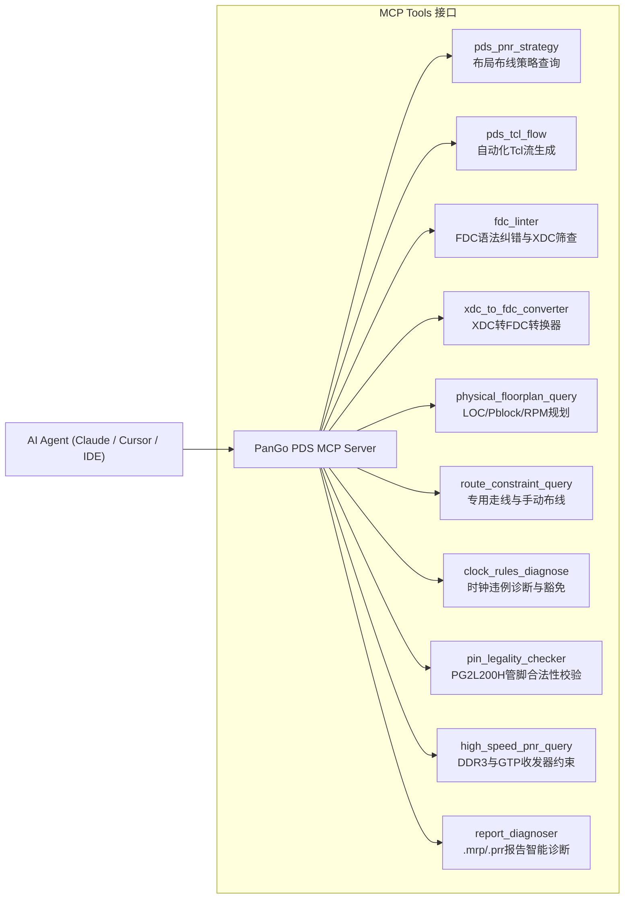

# PanGo PDS Place & Route Expert MCP Server
# (紫光同创 PDS 布局布线与物理约束专家 MCP 服务器)

[](https://modelcontextprotocol.io/)
[](http://www.pango.com.cn/)
[](https://python.org/)
[](LICENSE)

一个专为 **紫光同创 PDS (Pango Design Suite)** 与 **Logos-2 系列 FPGA (盘古 200Pro / PG2L200H)** 打造的 **Model Context Protocol (MCP)** 知识与自动化专家服务器。

为接入任何大模型（Claude、Antigravity、Cursor、Copilot、DeepSeek 等）提供专业的 PDS 布局布线策略推理、标准 `.fdc` 约束检查与转换、物理平面规划（LOC/Pblock/RPM）、专用时钟走线避坑、引脚合法性校验以及 `.mrp` / `.prr` 报告智能诊断。

---

## 🚀 核心解决痛点

| 痛点场景 | 传统困境 | 本 MCP 服务器提供的能力 |
| :--- | :--- | :--- |
| **时序与拥塞调优** | 不熟悉 PDS 复杂的 `dev_map` 与 `dev_pnr` 命令行选项 | 提供 `timing_driven`、`congestion_reduction`、`zero_dsp_bnn` 策略及多种子探索 Tcl 脚本 |
| **约束语法混淆** | 习惯性写出 Vivado XDC (`set_property PACKAGE_PIN`) 导致 PDS 报错 | 专有 FDC Linter 实时纠错，提供一键 XDC 转 PanGo FDC 转换器 |
| **物理平面规划** | 模块相互牵扯导致时序严重抖动 | 指导标准 Pblock、Region 与 RPM 相对位置宏语法，锁定 DRM/APM |
| **时钟布线违例** | 普通引脚接时钟触发 `Clock Routing Rule Violation` | 查验 GCLK/RCLK/IOCLK 网络与 10 GPLL+10 PPLL，提供直连与豁免方案 |
| **引脚电气冲突** | 同一 Bank 分配不同 VCCIO (如 3.3V 混搭 1.5V) 导致 DRC 崩溃 | 基于 PK04009 引脚库即时校验引脚功能（专用时钟、DQS、HSSTLP） |
| **高速硬核配置** | 盘古 200Pro 板载 DDR3 与 GTP SerDes 报错 | 提供 HMIC 字节组对齐规则及 HSSTLP 物理通道锁定约束模板 |

---

## 🛠️ 提供的 MCP Tools 工具集



| 工具函数名 | 输入参数 | 核心功能 |
| :--- | :--- | :--- |
| `pds_pnr_strategy` | `goal: str` | 查询时序收敛、拥塞缓解、零DSP计算流的 P&R 推荐参数 |
| `pds_tcl_flow` | `flow_type: str` | 导出可以直接在 `pds_shell` 批处理运行的自动化编译 Tcl 脚本 |
| `fdc_linter` | `fdc_content: str` | 诊断 `.fdc` 约束文件，精准捕获误用的 Vivado XDC 语句并给出正确替换 |
| `xdc_to_fdc_converter` | `xdc_content: str` | 将 Vivado XDC 代码块自动转换为标准的 PanGo FDC 语法 |
| `physical_floorplan_query`| `query_type: str` | 查询 DRM/APM/Slice 物理锁定 LOC 语法、Pblock 区域划分与 RPM 规范 |
| `route_constraint_query` | `feature: str` | 查询 GCLK/RCLK 走线提升、固定走线锁定及 Design Editor 手工布线方法 |
| `clock_rules_diagnose` | `error_message: str` | 诊断时钟专用走线违例，并给出硬件与软件豁免方案 |
| `pin_legality_checker` | `pin: str, desired_function: str` | 校验 PG2L200H-FBB484 引脚是否为专用时钟输入、DQS 选通或普通 IO |
| `high_speed_pnr_query` | `interface: str` | 提供 DDR3 HMIC 字节对齐约束与 GTP HSSTLP 物理通道锁定模板 |
| `report_diagnoser` | `report_text: str` | 解析 `.mrp`（资源与IOB打包）与 `.prr`（WNS/WHS/未布通网络）报告 |

---

## 📦 提供的 MCP Resources 资源集

* `pds://guides/pnr-optimization`：PDS 布局布线时序与拥塞优化完整指南。
* `pds://guides/fdc-syntax-reference`：PanGo FDC 时序与物理属性完整速查手册。
* `pds://guides/logos2-clock-architecture`：Logos-2 时钟拓扑、GPLL/PPLL 引脚映射指南。
* `pds://guides/pg2l200h-pinout-table`：PG2L200H-FBB484 专用引脚与 Bank 分布表。

---

## 💻 本地 CLI 命令行独立使用工具

除了作为 MCP 服务器供 AI 调用，本项目自带完整的独立终端 CLI 工具：

```bash
# 1. 启动 MCP 服务器 (stdio 模式)
pds-mcp run

# 2. 检查 .fdc 约束文件中的 XDC 语法错误
pds-mcp lint ./examples/sample_constraint.fdc

# 3. 将 Vivado .xdc 文件批量转换为 PanGo .fdc
pds-mcp convert ./vivado_pins.xdc -o ./pds_pins.fdc

# 4. 校验 PG2L200H 管脚是否合法 (例如验证 Y12 是否为专用时钟)
pds-mcp check-pin Y12 --function clock_input
# 输出: Pin: Y12 | Legal: True | Role: Dedicated Global Clock Input

# 5. 生成自动化 pds_shell 批处理脚本
pds-mcp tcl --flow complete_batch_flow > run_pds.tcl
```

---

## ⚙️ 接入主流 AI Agent 配置说明

### 1. Claude Desktop 配置 (`claude_desktop_config.json`)
```json
{
  "mcpServers": {
    "pango-pds-pnr-expert": {
      "command": "python",
      "args": ["-m", "pango_pds_mcp"]
    }
  }
}
```

### 2. Cursor / Continue / VS Code 插件配置
```json
{
  "mcpServers": {
    "pango-pds-pnr-expert": {
      "command": "python",
      "args": ["-m", "pango_pds_mcp"],
      "env": {}
    }
  }
}
```

---

## 📚 知识库参考手册索引 (Docs)

* [P0: PDS 布局布线与器件映射优化指南](docs/P0_PDS_PNR_USER_GUIDE.md)
* [P0: PDS 物理位置锁定与平面规划指南 (LOC/Pblock/RPM)](docs/P0_PHYSICAL_CONSTRAINT_GUIDE.md)
* [P0: PDS 布线约束与手工布线调整指南 (Design Editor)](docs/P0_ROUTE_CONSTRAINT_GUIDE.md)
* [P0: PDS 用户约束 .fdc 语法全解与 XDC 避坑指南](docs/P0_FDC_USER_CONSTRAINT_GUIDE.md)
* [P1: Logos-2 系列时钟网络拓扑与时钟布线规则指南 (UG040004)](docs/P1_LOGOS2_CLOCK_GUIDE.md)
* [P1: Logos-2 系列输入输出接口与引脚打包指南 (UG040006)](docs/P1_LOGOS2_IO_GUIDE.md)
* [P1: PG2L200H-FBB484 封装管脚与专用引脚映射全解 (PK04009)](docs/P1_PG2L200H_FBB484_PINOUT.md)
* [P2: DDR3 内存与 GTP 高速串行收发器布局布线约束指南](docs/P2_DDR3_GTP_PNR_GUIDE.md)

---

## 📄 License
本项目采用 [Apache-2.0 License](LICENSE) 开源协议。
