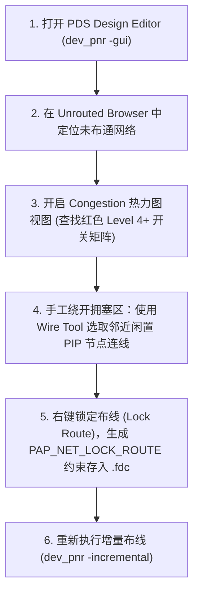

# P0: Route Constraint and Design Editor Manual Routing Guide
# (紫光同创 PDS 布线约束与手工布线调整指南)

> **目标芯片**：紫光同创 Logos-2 系列 (PG2L200H / 盘古 200Pro)  
> **核心任务**：专用布线资源锁定、高扇出网络布线控制、关键网络锁定与 Design Editor 手工布线。

---

## 一、 专用布线资源分配与提升 (Net Route Type)

在复杂 FPGA 设计中，时钟使能信号、高扇出同步复位或局部关键时钟网络若被分配到普通布线通道（Fabric Routing），会造成极大的布线延迟和偏斜（Skew）。

在 `.fdc` 中可强制指定网络布线类型：

```tcl
# 1. 强制提升为全局时钟脊柱网络 (GCLK) - 偏斜最低、驱动力最强
define_attribute {n:clk_pixel_int} {PAP_NET_ROUTE_TYPE} {GLOBAL_CLOCK}

# 2. 强制提升为区域时钟网络 (RCLK) - 限制在 1~2 个 Clock Region 内高速分发
define_attribute {n:cam_rx_byte_clk} {PAP_NET_ROUTE_TYPE} {REGIONAL_CLOCK}

# 3. 锁定关键网络布线轨迹 (Lock Route) - 跨轮次编译完全保留原有走线
define_attribute {n:critical_timing_bus[*]} {PAP_NET_LOCK_ROUTE} {TRUE}
```

---

## 二、 关键数据通路最大走线延迟约束 (Max Delay Constraint)

当两级寄存器之间没有时钟沿依赖、或属于跨时钟域握手信号（CDC），为防止自动布线器在芯片周围“绕大圈（Snake Route）”，使用 `set_max_delay -datapath_only` 限制纯走线物理耗时：

```tcl
# 限制数据通路净延迟不超过 2.800ns
set_max_delay 2.800 -from [get_pins {u_tx_cdc/src_reg[*]/CLK}] \
                    -to   [get_pins {u_rx_cdc/dst_meta_reg[*]/D}] \
                    -datapath_only
```

---

## 三、 Design Editor 手工布线与拥塞修复流程

当自动布线器在最后的 0.5% 网络上卡死（反复报告 `Unrouted Nets` 或拥塞死锁），可通过 PDS 的 Design Editor 介入人工调整：



### 高扇出复位网络拥塞避坑指南：
* 若全局复位信号 `rst_n` 的扇出大于 1500，且未走 GCLK 专用布线树，会导致整个芯片布线拥塞。
* **解决法 1**：在 RTL 中添加最大扇出综合约束属性：
  ```verilog
  (* MAX_FANOUT = 150 *) wire sys_rst_n_tree = rst_n_sync;
  ```
* **解决法 2**：在 `.fdc` 中强制将复位信号分配到全局时钟缓冲树（GCLK）：
  ```tcl
  define_attribute {n:sys_rst_n} {PAP_NET_ROUTE_TYPE} {GLOBAL_CLOCK}
  ```
