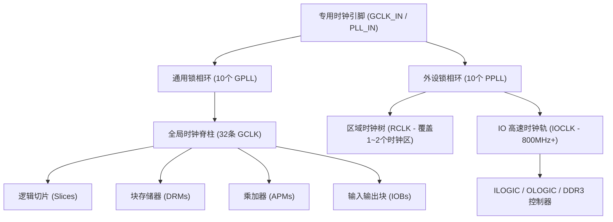

# P1: Logos-2 Clock Architecture and Routing Rules Guide (UG040004)
# (紫光同创 Logos-2 系列时钟网络拓扑与时钟布线规则指南)

> **目标芯片**：紫光同创 Logos-2 系列 (PG2L200H / 盘古 200Pro)  
> **核心任务**：解决“Clock Routing Rule Violation”时钟专用布线规则违例与跨时钟区时序违例。

---

## 一、 时钟网络拓扑结构：GCLK、RCLK 与 IOCLK

Logos-2 架构中设计了分层互连的时钟树体系：



### 1. 全局时钟 (Global Clock - GCLK)
* **数量**：共 32 条全局时钟通道。
* **特性**：全芯片对称 H 树结构，偏斜严格受控（Skew < 80ps），可驱动芯片内任意资源。
* **应用**：系统核心状态机、CNN 计算阵列的主频时钟。

### 2. 区域时钟 (Regional Clock - RCLK)
* **数量**：每个时钟区（Clock Region）内有 8 条 RCLK。
* **特性**：走线延迟极短（无穿区长线延迟），但只能驱动本区域及相邻水平时钟区。
* **应用**：局部协议接口（如 SPI、I2S、DVP 摄像头接收 FIFO 写时钟）。

### 3. I/O 高速时钟 (IOCLK)
* **特性**：直接嵌入在 IO Bank 内部，与 DDR3 的 DQS 选通脉冲和 IODELAY 硬件对齐，驱动 SERDES 并串/串并转换。

---

## 二、 锁相环 (GPLL 与 PPLL) 资源与管脚连接规则

PG2L200H 拥有多达 **10 个 GPLL + 10 个 PPLL**：
* **GPLL (General-Purpose PLL)**：负责复杂的频率合成与宽范围时钟去偏斜。
* **PPLL (Peripheral PLL)**：紧靠 IO Bank 边缘放置，相位噪声和抖动极低，专为高速存储器与 SERDES 定制。

### 专用时钟引脚直连规则（必读！）：
1. 外部差分或单端主时钟，**必须直接接入标记为 `GCLK_IN` 的专用管脚**。
2. 每一个 GPLL 都有对应的专用输入多路复用器（MUX）。若外部晶振接到了普通 GPIO 管脚，PDS 布线器必须借助普通 Fabric 逻辑走线将信号“跳线”送入 GPLL。这会触发 PDS 严重报警：
   ```text
   ERROR [CLK_ROUTE_001]: Clock Routing Rule Violation!
   The driver pin 'clk_in_ibuf' is an ordinary IO pad, which cannot route directly to GPLL dedicated pin.
   ```

---

## 三、 Clock Routing Rule Violation 两种解决方案

### 方案 A：原理图设计期或有备用管脚（彻底根治）
查阅 PK04009 管脚表，将主时钟绑定到真正的专用时钟管脚（如 Bank 0 的 `Y12` 或 Bank 1 的 `B10`）。

### 方案 B：PCB 已打样无法换引脚（软件豁免）
在 `.fdc` 约束中加入软件允许非专用布线豁免属性：
```tcl
define_attribute {n:clk_in_net} {PAP_CLOCK_DEDICATED_ROUTE} {FALSE}
```
并在 `dev_pnr` 执行时容忍时钟非专用绕线延迟（系统将自动插入一段约 1.2ns 的逻辑内联缓冲器）。
